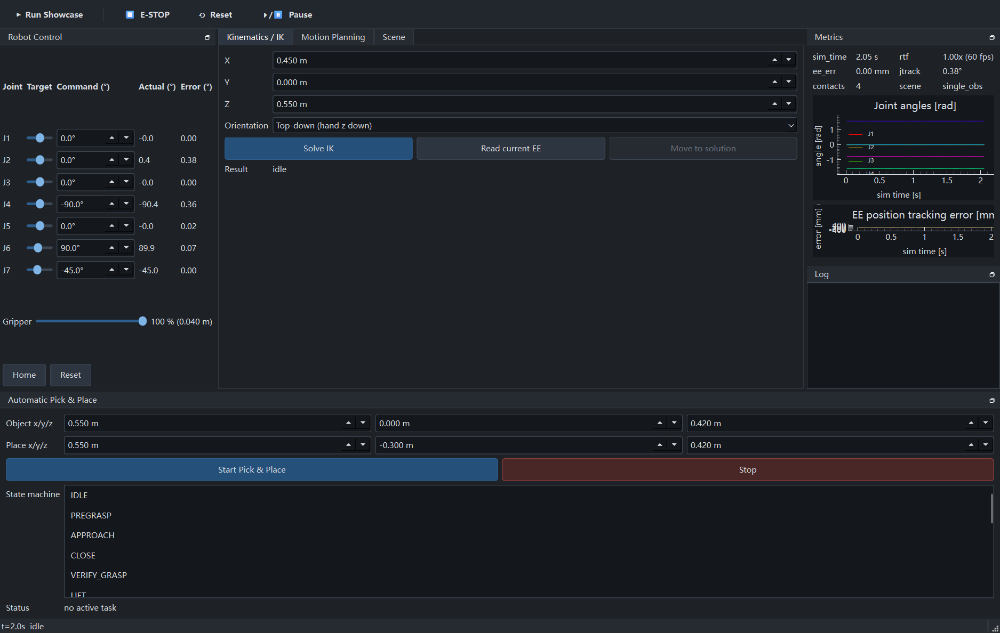
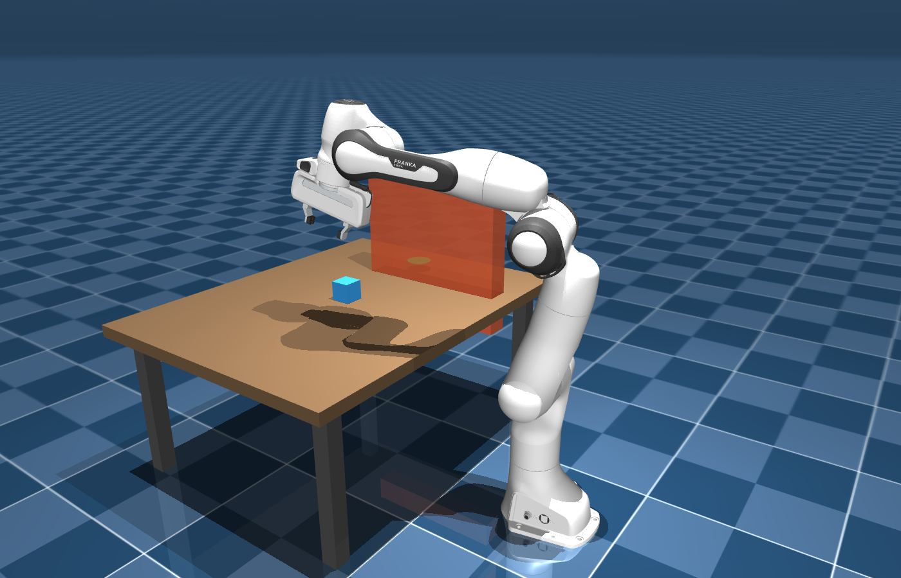
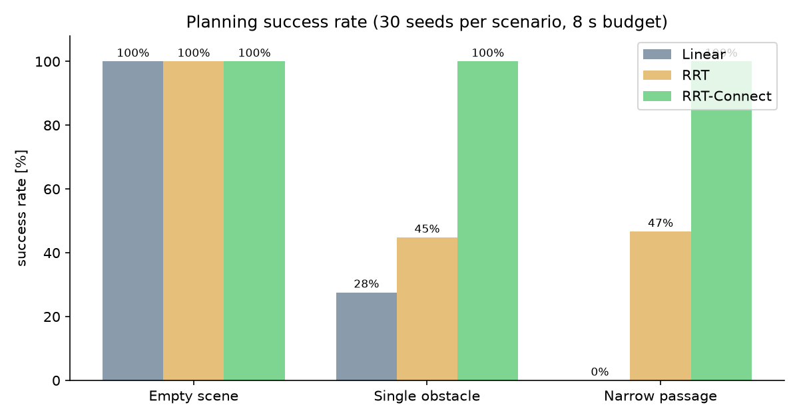
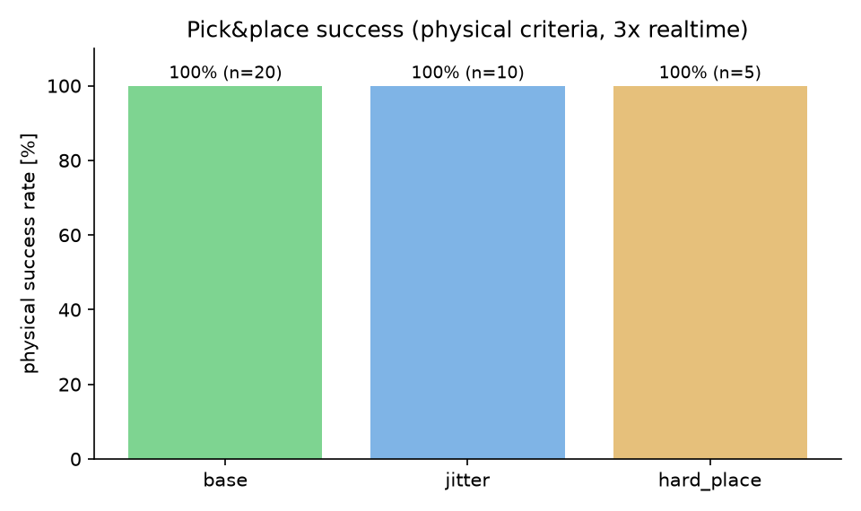

# RobotStudio — Interactive Robot Motion Planning & Manipulation Studio

RobotStudio is a desktop application for **interactive robot motion planning,
simulation and physical manipulation** built on MuJoCo and the Franka Emika
Panda. Load a robot, configure a scene, solve inverse kinematics, plan
collision-free paths with RRT / RRT-Connect, execute them through real
physics — and run a fully automatic, physically-verified **pick & place**
task, all without writing code.

| | |
|---|---|
|  |  |
| *Main window: joint control, IK, metrics, grasp FSM* | *Panda executing a planned path around an obstacle (MuJoCo render)* |

## What it does

The complete product flow, every step real:

```
load robot -> configure scene -> set target -> solve IK -> collision check
-> plan path (RRT / RRT-Connect / linear baseline) -> time-parameterize
-> execute in physics -> automatic pick & place (15-state FSM)
-> result analysis -> export reports
```

- **3D physics simulation** (MuJoCo passive viewer) with pause / resume /
  reset, realtime-factor control and live status.
- **Joint control** for all 7 joints with limits, targets, actual values and
  tracking error; gripper 0-100%.
- **IK solver**: damped least squares with adaptive damping, nullspace bias,
  multi-start and collision validation. Failures are reported with reasons —
  never silently converted into a wrong pose.
- **Planning**: RRT-Connect, RRT, RRT\*, Informed RRT\* and a straight-line
  baseline behind one unified API; randomized shortcutting; every reported
  path is re-validated by an independent collision checker; planned paths,
  the live end-effector trace and grasp contact points are drawn **in the 3D
  view** (green path capsules, cyan trace, red contacts).
- **One-click Showcase**: a toolbar button that runs the whole story -
  obstacle-scene sweep around a wall, then the full automatic pick & place -
  for demos and screen recording.
- **Trajectory execution**: time-scaled cubic splines numerically verified
  against joint velocity/acceleration limits; servo-streamed into the
  physics; settle-based completion; e-stop.
- **Automatic pick & place**: a 15-state finite state machine (pregrasp →
  approach → close → verify grasp → lift → transfer → place → release →
  verify place → retreat) with timeouts, retries and aborts. Grasp success is
  judged by **physical evidence** (fingertip-cube contacts, the cube actually
  rising with the gripper, final resting position) — no teleporting, no
  scripted animation.

## Independent implementation vs. reused components

| Reused (with attribution) | Independently implemented here |
|---|---|
| MuJoCo physics engine (Apache-2.0) | DLS inverse kinematics + SO(3) error math |
| Franka Panda MJCF model from [mujoco_menagerie](https://github.com/google-deepmind/mujoco_menagerie) (Apache-2.0, pinned revision, license bundled) | whitelist collision checking with dense segment validation |
| NumPy / SciPy / PySide6 / pyqtgraph | RRT and RRT-Connect (from the original papers) |
| | time-scaled cubic spline trajectory generation with numeric limit verification |
| | grasp geometry measured from the model, gripper force calibration |
| | the pick&place state machine and all physical success criteria |

See [THIRD_PARTY_NOTICES.md](THIRD_PARTY_NOTICES.md) for licenses.

## Installation (Windows)

```bat
git clone <this repo>
cd robotstudio
setup.cmd        :: creates .venv, installs pinned deps, self-check
run.cmd          :: launches the desktop app (control panel + MuJoCo viewer)
```

Requirements: Windows 10/11, Python 3.11+ on PATH, ~2 GB disk. No GPU, ROS,
WSL or cloud services needed; after `setup.cmd` the project runs fully
offline.

## Usage walkthrough

1. `run.cmd` opens the **control panel** and a **MuJoCo 3D viewer**.
2. Pick a preset scene (empty / tabletop / single obstacle / narrow passage)
   in the *Scene* tab; edit obstacle poses and apply — the viewer switches
   instantly.
3. Move joints with the sliders, or enter a target position in
   *Kinematics / IK* and press **Solve IK** → **Move to solution**.
4. In *Motion Planning*, choose an algorithm and seed, set goal joints,
   press **Plan** → **Execute** and watch the arm follow the trajectory in
   the viewer while the metrics plot tracking error.
5. In *Automatic Pick & Place*, set the object and place positions and press
   **Start Pick & Place**; the state-machine list highlights each phase as
   the robot physically grasps and places the cube.

Automated tests: `test.cmd` (64 tests: unit, integration, physics, GUI incl. real-viewer and showcase runs).

## Benchmarks

All numbers from real runs on this machine (raw data in
[reports/benchmarks/](reports/benchmarks/), full report in
[reports/BENCHMARKS.md](reports/BENCHMARKS.md)):

| Area | Result |
|---|---|
| IK (120 FK-derived reachable targets) | 100% solved, ≤ 5.0 mm / ≤ 2.8°, mean 9.9 ms, 0 false positives on 20 unreachable targets |
| Planning (3 scenes × 28-30 seeds × 3 planners) | RRT-Connect 100% everywhere (median 0.19–0.23 s); single-tree RRT 45–47% on blocked scenes; **0 of the 178 produced paths failed independent re-validation (261 trials)** |
| Optimal planning (RRT\* / Informed RRT\*, 20 s budget) | raw path costs consistently ≤ RRT's; Informed converges faster (see §6 + convergence chart) |
| Pick & place (35 physical trials) | base 20/20, jittered 10/10, table-edge 5/5; 3/3 impossible targets correctly rejected |
| Collision check cost | 0.052 ms per state |




## Documentation

- [ARCHITECTURE.md](ARCHITECTURE.md) — module map, threading model, data flow
- [docs/ALGORITHMS.md](docs/ALGORITHMS.md) — FK/Jacobian/DLS/RRT/splines/FSM math with references
- [docs/DECISIONS.md](docs/DECISIONS.md) — every technical decision and its evidence
- [reports/TEST_REPORT.md](reports/TEST_REPORT.md) — full test results (PASS/FAIL/SKIP)
- [reports/BENCHMARKS.md](reports/BENCHMARKS.md) — protocols, raw data, failure analysis
- [PORTFOLIO.md](PORTFOLIO.md) — interview-oriented project summary

## Known limitations (V1)

- One robot model (Panda); scene objects are primitives (box/sphere/cylinder).
- Obstacle editing covers position/size/enable — no arbitrary CAD import.
- FSM planning runs in the engine thread: the 3D viewer pauses briefly
  (~0.2–2 s) during planning phases. The GUI stays responsive.
- Windows-first: other platforms work where MuJoCo + PySide6 do, but the
  launcher scripts and the tested packaging are Windows.

## License

MIT for this repository's code — see [LICENSE](LICENSE). The bundled Panda
model is Apache-2.0 (license kept in `assets/robots/panda/LICENSE`);
third-party notices: [THIRD_PARTY_NOTICES.md](THIRD_PARTY_NOTICES.md).
