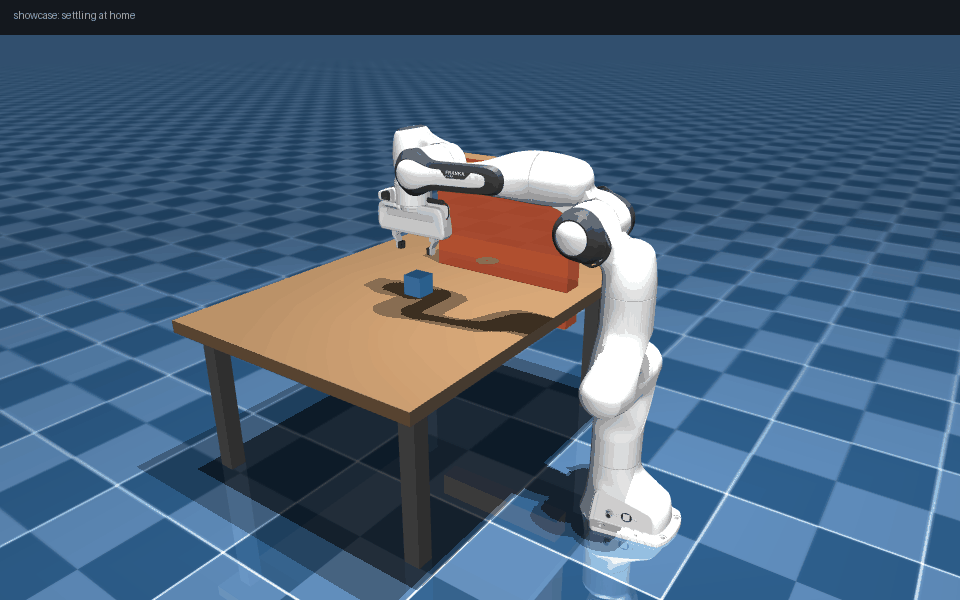
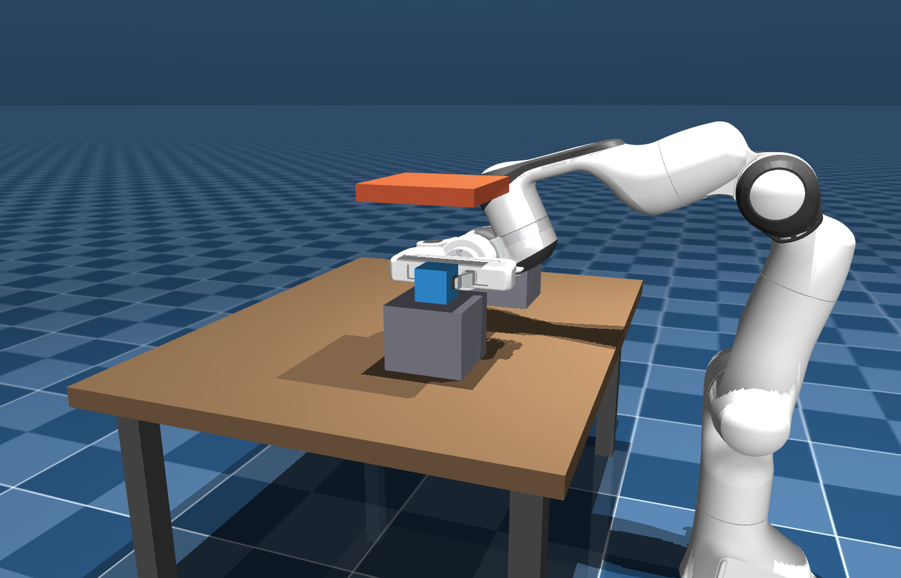

# PandaForge — Interactive Robot Motion Planning & Manipulation Studio

> Python package name: `robotstudio` (import name kept for compatibility).

[](reports/TEST_REPORT.md)
[](https://www.python.org/downloads/)
[](LICENSE)


PandaForge is a desktop application for **interactive robot motion planning,
simulation and physical manipulation** built on MuJoCo and the Franka Emika
Panda. Load a robot, configure a scene, solve inverse kinematics, plan
collision-free paths with RRT-Connect / RRT / RRT\* / Informed RRT\*, execute
time-optimal trajectories through real physics — and run a fully automatic,
physically-verified **pick & place** task, all without writing code.

**Verify everything in 60 seconds, no display needed:**

```bat
setup.cmd                          :: one-time install (Windows)
.venv\Scripts\python -m robotstudio.demo
```

```
[1] motion planning (RRT-Connect, collision-checked)
    success=True  waypoints=2  length=0.62 rad  time=18 ms
    independent re-validation: PASS
[2] trajectory execution (servo-streamed, settle-verified)
    completed=True  final joint error=0.59 deg
[3] automatic pick & place (15-state FSM, physical criteria)
    fsm verdict: SUCCESS
    PHYSICAL EVIDENCE: cube moved 299 mm, placed 6 mm from target,
    resting z=0.425 m, gripper open 40 mm
ALL CLAIMS VERIFIED
```



*One-click showcase (real simulation): planned sweep around an obstacle, then
a fully automatic, physically verified pick & place.*

| | |
|---|---|
|  |  |
| *Main window: joint control, IK, metrics, grasp FSM* | *Planned path (green capsules) around an obstacle* |

## Independent implementation vs. reused components

One fair question decides most robotics-hiring screens: *did you build this,
or wrap an existing stack?*

| Reused (with attribution) | Independently implemented here |
|---|---|
| MuJoCo physics engine (Apache-2.0) | DLS inverse kinematics + SO(3) error math |
| Franka Panda MJCF model from [mujoco_menagerie](https://github.com/google-deepmind/mujoco_menagerie) (Apache-2.0, pinned revision, license bundled) | whitelist collision checking with dense segment validation |
| NumPy / SciPy / PySide6 / pyqtgraph | RRT, RRT-Connect, RRT\*, Informed RRT\* (from the original papers) |
| | TOPP-RA time-optimal trajectory parameterization |
| | antipodal grasp candidate generation with automatic side-grasp fallback |
| | the pick&place state machine and all physical success criteria |

See [THIRD_PARTY_NOTICES.md](THIRD_PARTY_NOTICES.md) for licenses.

## What it does

```
load robot -> configure scene -> set target -> solve IK -> collision check
-> plan path (RRT-Connect / RRT / RRT* / Informed RRT* / linear baseline)
-> TOPP-RA time-optimal parameterization -> execute in physics
-> automatic pick & place (15-state FSM) -> result analysis
```

- **3D physics simulation** (MuJoCo passive viewer) with pause / resume /
  reset, realtime-factor control; planned paths, the live end-effector trace
  and grasp contact points are drawn **in the 3D view**.
- **Joint control** for all 7 joints with limits, targets, actual values and
  tracking error; gripper 0-100%.
- **IK solver**: damped least squares with adaptive damping, nullspace bias,
  multi-start and collision validation. Failures are reported with reasons.
- **Planning**: one unified API; randomized shortcutting; every reported
  path is re-validated by an independent collision checker.
- **TOPP-RA trajectories**: reachability-analysis time-optimal
  parameterization, numerically verified against joint velocity/acceleration
  limits; settle-based completion; e-stop.
- **Antipodal grasp planning**: top-down plus four side-grasp candidates; the
  first collision-free one is used — when a roof blocks the top approach
  (`roof_grasp` preset) the robot automatically performs a horizontal side
  grasp, shelf-to-shelf.

  

  *Roof blocks the top-down approach → the planner automatically selects a
  horizontal side grasp (real simulation frame).*
- **Automatic pick & place**: a 15-state FSM with timeouts, retries and
  aborts. Success is judged by **physical evidence** (fingertip-cube
  contacts, the cube actually rising with the gripper, final resting
  position) — no teleporting, no scripted animation.
- **Online replanning under a moving obstacle**: a panel sweeps the
  workspace on a known script; execution is guarded by swept-volume checks
  (reference AND physical arm, 1.2 s horizon) and replans through a
  cycle-verified park configuration when the corridor closes
  (``moving_wall`` preset).
- **One-click Showcase** toolbar button: obstacle-scene sweep + full pick &
  place for demos and screen recording.

## Installation (Windows)

```bat
git clone <this-repository-url>
cd pandaforge
setup.cmd        :: creates .venv, installs pinned deps, self-check
run.cmd          :: launches the desktop app (control panel + MuJoCo viewer)
```

Replace `<this-repository-url>` with your clone URL (the badges above are
relative and work from any fork).

Requirements: Windows 10/11, Python 3.11+ on PATH, ~2 GB disk. No GPU, ROS,
WSL or cloud services needed; after `setup.cmd` the project runs fully
offline.

**Linux/macOS:**

```bash
python -m venv .venv && .venv/bin/pip install -r requirements.txt && .venv/bin/pip install -e . --no-deps
.venv/bin/python -m robotstudio.demo      # headless proof, no display needed
.venv/bin/python -m robotstudio           # full desktop app
```

(`requirements.txt` = verified ranges; `requirements-lock.txt` reproduces
the exact benchmark environment. CI runs the full suite on both
`windows-latest` and `ubuntu-latest`.)

## Usage walkthrough

1. `run.cmd` opens the **control panel** and a **MuJoCo 3D viewer**.
2. Pick a preset scene (empty / tabletop / single obstacle / narrow passage /
   roof grasp) in the *Scene* tab; edit obstacle poses and apply.
3. Move joints with the sliders, or enter a target position in
   *Kinematics / IK* and press **Solve IK** → **Move to solution**.
4. In *Motion Planning*, choose an algorithm and seed, set goal joints,
   press **Plan** (the path appears in the 3D view) → **Execute**.
5. In *Automatic Pick & Place*, set the object and place positions and press
   **Start Pick & Place**; the state-machine list highlights each phase.
6. Or just press **▶ Run Showcase** in the toolbar.

Automated tests: `test.cmd` (73 tests: unit, integration, physics, GUI incl.
real-viewer and showcase runs).

## Benchmarks

All numbers from real runs (raw data in
[reports/benchmarks/](reports/benchmarks/), full report in
[reports/BENCHMARKS.md](reports/BENCHMARKS.md)):

| Area | Result |
|---|---|
| IK (120 FK-derived reachable targets) | 100% solved, ≤ 5.0 mm / ≤ 2.8°, mean 9.9 ms, 0 false positives on 20 unreachable targets |
| Planning (3 scenes × 28-30 seeds × 3 planners) | RRT-Connect 100% everywhere (median 0.19–0.23 s); **0 of the 178 produced paths failed independent re-validation (261 trials)** |
| Optimal planning (RRT\* / Informed RRT\*) | raw path costs ≤ RRT's (-21…-26% where solvable); convergence histories committed |
| Pick & place (physical trials) | base 20/20, jittered 10/10, table-edge 5/5, roof side-grasp 5/5; 3/3 impossible targets correctly rejected |
| Online replanning (moving panel) | guarded: 100% zero-contact completion, median double-digit replans; unguarded baseline gets hit (see §7) |
| Collision check cost | 0.052 ms per state |


## How we know it's real

- An [independent audit](reports/FINAL_AUDIT.md) re-ran the suite and
  recomputed every benchmark from the raw CSVs before approval.
- Failure archaeology, kept in [reports/BENCHMARKS.md](reports/BENCHMARKS.md):
  the grasp that slipped → measured gripper force curve; the "successful"
  trajectory that wasn't → a 22 mm gravity ratchet caused by servo-lag
  freezing, fixed with settle-based completion and covered by tests.
- The test suite opens a REAL viewer window and runs the REAL showcase
  end-to-end (`tests/gui/test_viewer.py`, `test_showcase.py`).

## Documentation

- [ARCHITECTURE.md](ARCHITECTURE.md) — module map, threading model, data flow
- [docs/ALGORITHMS.md](docs/ALGORITHMS.md) — FK/Jacobian/DLS/RRT*/TOPP-RA/grasp math with references
- [docs/DECISIONS.md](docs/DECISIONS.md) — every technical decision and its evidence
- [reports/TEST_REPORT.md](reports/TEST_REPORT.md) — full test results
- [reports/BENCHMARKS.md](reports/BENCHMARKS.md) — protocols, raw data, failure analysis
- [PORTFOLIO.md](PORTFOLIO.md) — interview-oriented summary

## 5-minute code tour

| Start here | What you'll find |
|---|---|
| [`kinematics/ik.py`](src/robotstudio/kinematics/ik.py) | the DLS core (~120 lines): adaptive damping, SO(3) log error |
| [`planning/rrt.py`](src/robotstudio/planning/rrt.py) | RRT / RRT-Connect with vectorized nearest-neighbour trees |
| [`trajectory/toppra.py`](src/robotstudio/trajectory/toppra.py) | TOPP-RA reachability analysis (backward controllable set + greedy forward pass) |
| [`manipulation/fsm.py`](src/robotstudio/manipulation/fsm.py) | the 15-state pick & place machine |
| [`reports/BENCHMARKS.md`](reports/BENCHMARKS.md) | every claim, with raw data |

## Known limitations

- One robot model (Panda); scene objects are primitives (box/sphere/cylinder).
- FSM planning runs in the engine thread: the 3D viewer pauses briefly
  (~0.2–2 s) during planning phases. The GUI stays responsive.
- Windows-first packaging (`.cmd` scripts); Linux/macOS work headless and in
  CI, but the desktop launch scripts are Windows-only.
- Single-tree optimal planners (RRT\*) trade first-solution speed for
  optimality on blocked 7-D scenes — measured, reported, not tuned away.

## Contributing

Bug reports, algorithm work, and UI improvements are welcome — read
[CONTRIBUTING.md](CONTRIBUTING.md) for the project's ground rules
(single-owner engine, no Qt in planners, evidence required for every
claim). Security topics: [SECURITY.md](SECURITY.md). If you use PandaForge
in your work, cite it via [CITATION.cff](CITATION.cff).

## License

MIT for this repository's code — see [LICENSE](LICENSE). The bundled Panda
model is Apache-2.0 (license kept in `assets/robots/panda/LICENSE`);
third-party notices: [THIRD_PARTY_NOTICES.md](THIRD_PARTY_NOTICES.md).
